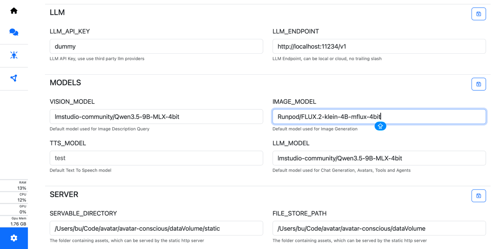
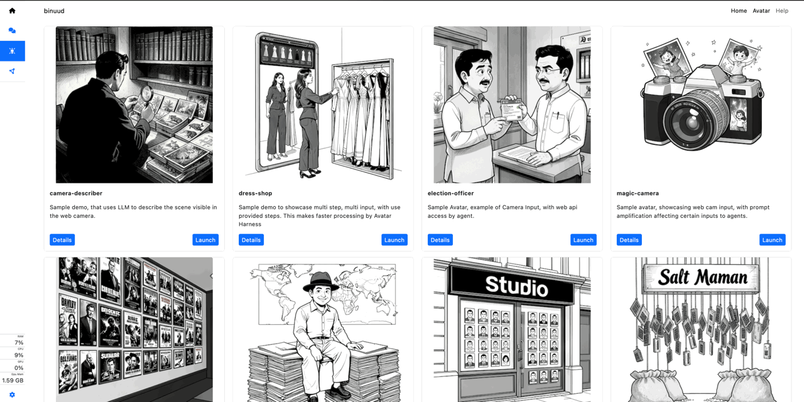

## Avatar-dev-ui

Avatar Development UI

Customers will get their own white labelled UI.

# avatar

[Detailed Documentation](https://binuud.com/docs/avatar)

[Avatar Full Project](https://github.com/binuud/avatar)

Please refer to above link for the latest documentation.

Real World facing AI Agents, with memory, MCP Server Management, tool management. Tool whitelisting at agent level.

* Build your own customer facing agents
* Agents for Home Automation
* Harness for Agents
* MCP Server Manager
* White list MCP Server Access at agent level

Project status - open for alpha users

